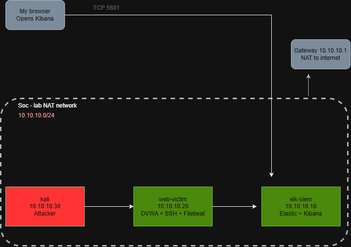

# ELK SOC Home Lab

A self-built security operations lab: a SIEM (Elastic Stack) collecting logs from a deliberately vulnerable web server, attacked from a Kali Linux VM, with detections and dashboards built to catch each attack.

> All attacks in this project were run against my own virtual machines on an isolated lab network. Nothing here targets systems I don't own.

## Architecture



| VM | IP | Role | Key ports |
|---|---|---|---|
| `elk-siem` | 10.10.10.10 | Elasticsearch, Logstash, Kibana (Docker) | 9200, 5044, 5601 |
| `web-victim` | 10.10.10.20 | DVWA + SSH, ships logs with Filebeat | 80, 22 |
| `kali` | 10.10.10.30 | Attacker | — |

Network: VirtualBox NAT Network `soc-lab`, 10.10.10.0/24, gateway 10.10.10.1. No inbound access from outside the host.

## Tools

Elastic Stack 9.x · Docker · Filebeat · Ubuntu Server · DVWA · Kali Linux · Nmap · Hydra · VirtualBox

## Progress

- [ ] Phase 1: Plan the lab (hardware, hypervisor, network, diagram)
- [ ] Phase 2: Build the SIEM
- [ ] Phase 3: Build the victim and ship logs
- [ ] Phase 4: Run attacks from Kali
- [ ] Phase 5: Detect them (dashboard + alert rules)
- [ ] Phase 6: Write up findings
- [ ] Phase 7: Extras (pfSense, jump box, Elastic Agent, Azure)

## Attacks and detections

| Attack | Tool | Log source | Detection | Screenshot |
|---|---|---|---|---|
| Port scan | Nmap | | | |
| SSH brute force | Hydra | | | |
| SQL injection | Browser / sqlmap | | | |

## What I learned

<!-- Fill in as you go: problems you hit, how you fixed them, what surprised you. -->

## Repo layout

```
docs/       diagram, screenshots, project log
configs/    sanitized config files (no secrets)
```
